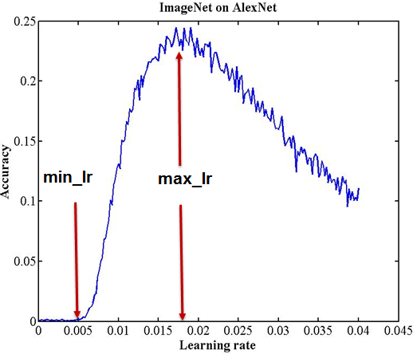
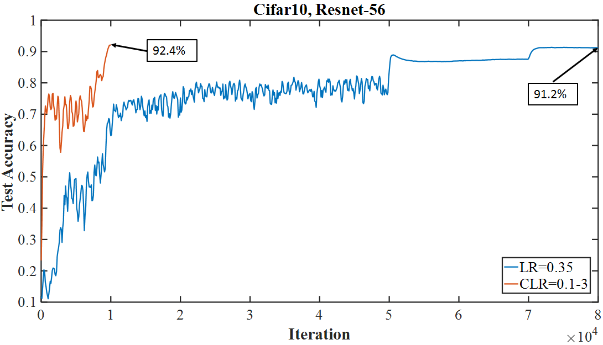
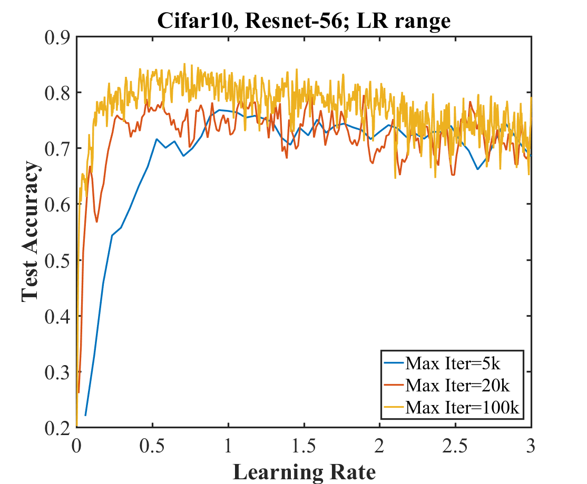

# Презентация. Super-Convergence

Smith L. N., Topin N. Super-Convergence: Very Fast Training of Neural Networks Using Large Learning Rates. arXiv:1708.07120, 2017.

Пять частей, 12 слайдов. Под каждым слайдом сначала текст на слайде, затем реплика к рассказу.

## 1. Проблематика и идея

### Слайд 1. Титульный

**На слайде**

- Super-Convergence: очень быстрое обучение большим learning rate
- Smith, Topin, arXiv:1708.07120
- ResNet-56, CIFAR-10
- Вопрос: можно ли получить ту же точность в разы меньшим числом итераций

**К рассказу.** Дальше четыре части: зачем это понадобилось, как проверяли, что получилось у авторов и у нас, и какое правило из этого забирать в практику.

### Слайд 2. Почему обычное обучение долгое

**На слайде**

- Стандарт для ResNet на CIFAR: ступенчатый learning rate
- Долго держат шаг около 0.1–0.35, пока точность не выйдет на полку
- Потом делят шаг на 10 и снова ждут полку
- Для ResNet-56 это 80 000 итераций и около 91.2%
- Большую часть времени сеть сидит на полке и почти не улучшается
- Верхнюю границу шага берут «как обычно», не проверяя, какой большой шаг сеть ещё переносит

**К рассказу.** Необходимость исследования в том, что длина обучения выбрана по привычке. Если сеть выдерживает шаг на порядок больше, длинные полки не нужны.

### Слайд 3. Идея

**На слайде**

- Сначала измерить, до какого learning rate точность ещё держится
- Если обвала нет, поставить один треугольный цикл до этой границы
- В начале шаг маленький, в середине очень большой, в конце снова маленький
- Для ResNet-56 верхняя граница оказывается равна 3, а не 0.1
- Ожидание: та же или более высокая точность за 10 000 итераций вместо 80 000

**К рассказу.** Идея не в новой сети и не в новом оптимизаторе. Меняется только расписание шага: один подъём и один спуск вместо двух длинных полок.

## 2. Методы исследования

### Слайд 4. Гипотеза и что сравнивают

**На слайде**

- Гипотеза: один цикл 0.1 → 3.0 → 0.1 догоняет ступенчатое обучение и делает это в 8 раз короче
- Контроль: piecewise, learning rate 0.35, деление на 10 на итерациях 50 000 и 70 000, всего 80 000 итераций
- Проверка: triangular CLR, stepsize 5 000, всего 10 000 итераций
- Сеть и данные одни и те же: ResNet-56, CIFAR-10
- Метрика: test accuracy на всех 10 000 тестовых картинках
- Отдельный прогон, LR range test, отвечает на вопрос, почему верх цикла равен 3

**К рассказу.** Сравнивают два расписания, а не две архитектуры. Range test идёт до основного обучения и только выбирает границы цикла.

### Слайд 5. Как выбирают границы цикла

**На слайде**

- LR range test: learning rate линейно растёт от почти нуля до большого значения
- На графике test accuracy против learning rate
- Обычная кривая имеет пик: до пика сеть учится, после пика шаг уже слишком большой
- `max_lr` ставят в район пика, `base_lr` берут в 3–4 раза меньше
- Рисунок из статьи, Figure 2(a): типичный range test с явным пиком

**К рассказу.** Этот график — ImageNet и AlexNet, он нужен как образец обычного поведения. Пик показывает максимальный полезный шаг. Дальше авторы смотрят, есть ли такой пик у ResNet-56 на CIFAR-10.

### Слайд 6. Чем проверяли мы

**На слайде**

- Тот же ResNet-56: каналы 16–32–64, первая свёртка 3×3 со stride 1
- SGD, momentum 0.9, weight decay 10⁻⁴
- Картинки в шкале 0..255 минус среднее обучающей выборки, на обучении только отражение
- Цикл статьи: batch 1000, BatchNorm `moving_average_fraction` 0.95
- Длинный baseline: batch 125, как в prototxt, `moving_average_fraction` 0.999
- MacBook Pro, Apple M4 Pro, PyTorch 2.3.1, MPS, seed 0
- Два наших прогона повторяют Figure 1(a), третий повторяет Figure 2(b)

**К рассказу.** В Table 5 у первой свёртки написан stride 2. В prototxt статьи stride равен 1, и в коде стоит 1. Статистика BatchNorm перенесена по формуле Caffe, иначе на коротком прогоне test loss раздувается.

## 3. Результаты

### Слайд 7. Figure 1(a): статья и наш прогон

**На слайде**

- Слева статья: оранжевый цикл доходит до 92.4% за 10 000 итераций, синий ступенчатый режим — до 91.2% за 80 000
- Справа наш прогон: цикл с batch 1000 заканчивается на 92.31%, ступенчатый режим с batch 125 — на 91.99%

**К рассказу.** Форма совпадает. Короткий цикл уже стоит на верхней полке, когда длинный ещё колеблется. У нас на итерации 50 000 ступенчатый прогон имеет 57.14%, на 70 000 — 87.16%, и только к 80 000 доходит до 91.99%.

### Слайд 8. Числа

**На слайде**

| | 10 000 итераций | 80 000 итераций |
| --- | ---: | ---: |
| Статья | 92.4% | 91.2% |
| Наш прогон | 92.31% | 91.99% |

- 10 000 итераций у нас: triangular CLR, batch 1000
- 80 000 итераций у нас: piecewise, batch 125
- Лучшие соседние точки: 92.34% на итерации 9900 и 92.06% на итерации 74 900
- Тот же цикл при batch 125 даёт 85.08%
- В статье batch 256 → 89.5%, batch 512 → 91.7%, batch 1000 → 92.4%

**К рассказу.** На длинах из Figure 1(a) расхождение меньше одного пункта. Провал до 85% появляется только когда батч цикла сильно меньше батча статьи.

### Слайд 9. Figure 2(b): range test в статье и у нас

**На слайде**

- Слева статья: у ResNet-56 нет пика и обвала, точность держится примерно на 70–85% вплоть до learning rate 3
- Справа наш прогон, 5 000 итераций, batch 1000: на отрезке 0.5–3.0 точность остаётся между 61% и 80%
- При learning rate 3.0 у нас 63.68%, случайный уровень на CIFAR-10 около 10%
- Поэтому верх цикла ставят равным 3

**К рассказу.** Это не финальная точность модели, а проба шага. В статье кривые для 5 000, 20 000 и 100 000 итераций похожи. Наш короткий прогон повторяет главный признак: при шаге 3 сеть всё ещё обучается.

## 4. Выводы

### Слайд 10. Выводы

**На слайде**

- Гипотеза подтверждается: один цикл с learning rate до 3 доходит до точности длинного обучения
- Итераций нужно в 8 раз меньше, 10 000 против 80 000
- У нас 92.31% против 91.99%, в статье 92.4% против 91.2%
- Оба наших числа лежат в пределах одного пункта от статьи
- Range test объясняет выбор границы: при learning rate 3 обвала к 10% нет
- Число 92.4% привязано к batch 1000. При batch 125 тот же цикл даёт 85.08%

**К рассказу.** Эффект есть и в статье, и в переносе на PyTorch. Сдвиг на доли пункта объясняется батчем и переносом BatchNorm, а не отсутствием самого явления.

## 5. Практическое применение

### Слайд 11. Что забирать из статьи

**На слайде**

- Перед длинным обучением сделать LR range test
- Если точность держится до необычно большого шага, super-convergence для этой сети доступна
- Поставить один цикл: `base_lr` в 3–4 раза ниже найденной границы, `max_lr` на этой границе
- Шаг растёт линейно половину цикла и так же линейно падает
- Длину цикла взять порядка нескольких тысяч–десятков тысяч итераций, не копировать 80 000
- С большим шагом ослабить другую регуляризацию: увеличить батч, не добавлять лишний dropout и слишком большой weight decay
- Для короткого прогона уменьшить `moving_average_fraction` BatchNorm, чтобы статистика успела обновиться

**К рассказу.** Главное знание такое. Сначала измеряют допустимый шаг, потом один раз поднимают его и опускают. Для ResNet-56 на CIFAR-10 это даёт около 92% за 10 000 итераций вместо 80 000.

### Слайд 12. Правило одной строкой

**На слайде**

- Найти по range test самый большой learning rate, на котором точность ещё жива
- Обучить сеть одним треугольником до этого значения и обратно
- Держать батч крупным, а статистику BatchNorm быстрой
- Ожидать ту же точность за долю обычного числа итераций

**К рассказу.** На этом можно заканчивать. Воспроизведение Figure 1(a) показывает, что правило работает и вне исходного кода на Caffe.
