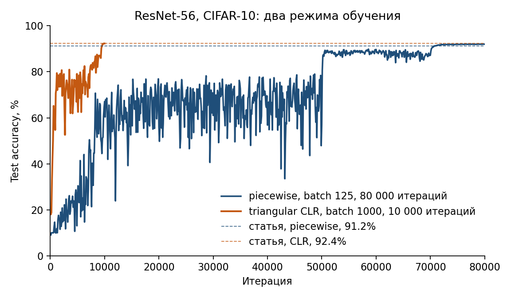
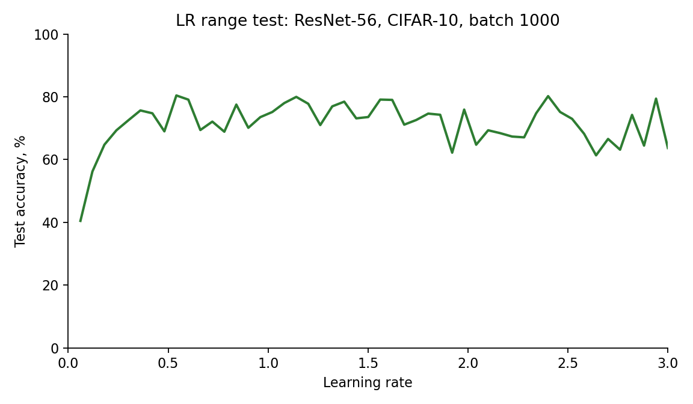

# Воспроизведение Super-Convergence

Smith L. N., Topin N. Super-Convergence: Very Fast Training of Neural Networks Using Large Learning Rates. arXiv:1708.07120, 2017.

Воспроизводится Figure 1(a): ResNet-56 на CIFAR-10. Код прогонов лежит в `hw2/baseline.py`, `hw2/clr.py` и `hw2/range_test.py`, логи — в `hw2/results/`.

## Что утверждает статья и какие два числа проверяем

Статья утверждает, что один треугольный цикл learning rate доводит ResNet-56 на CIFAR-10 до более высокой test accuracy, чем обычное ступенчатое расписание, и делает это в восемь раз меньшим числом итераций.

Проверяются два числа из Figure 1(a).

1. Piecewise-constant. Learning rate 0.35, деление на 10 на итерациях 50 000 и 70 000. За 80 000 итераций test accuracy около **91.2%**.
2. Super-convergence. Triangular CLR: learning rate 0.1 → 3.0 за 5 000 итераций и обратно к 0.1 ещё за 5 000. За 10 000 итераций test accuracy около **92.4%**.

Число 92.4% в статье получено при total batch 1000 (Table 7). Отношение длин двух прогонов равно 80 000 / 10 000 = 8.

## Железо, версии PyTorch, seed, отличия от Caffe

Считалось на MacBook Pro, чип Apple M4 Pro, 24 ГБ памяти, macOS 15.3.2. Устройство — MPS. PyTorch 2.3.1, torchvision 0.18.1. Seed во всех завершённых прогонах равен 0.

С Caffe совпадают SGD, momentum 0.9, weight decay 10⁻⁴ и предобработка: картинки в шкале 0..255 минус попиксельное среднее обучающей выборки, на обучении отражение слева направо с вероятностью 0.5, на тесте аугментации нет. Потери — средняя кросс-энтропия.

Дальше перечислены отличия, из-за которых абсолютные проценты могут сдвинуться.

**Stride первой свёртки.** В Table 5 у первой свёртки указан stride 2. В `Resnet56Cifar.prototxt` из репозитория статьи stride равен 1: для CIFAR карта 32×32 на первом слое не уменьшается. В коде стоит stride 1.

**Перевод MAF в momentum.** Caffe задаёт `moving_average_fraction`. Счётчик обновляется как `S = maf·S + 1`, и скользящее среднее делится на `S`, поэтому первый батч целиком задаёт статистику. В PyTorch аргумент `momentum` у `BatchNorm2d` — это доля нового батча в обычном EMA, а `running_var` стартует с 1. Подстановка `momentum = 1 − maf` на коротком прогоне раздувает test loss. В коде на шаге `t` momentum равен `1/S_t`, где `S_t = (1 − maf^t) / (1 − maf)`. Для 80 000 итераций `maf = 0.999`. Для цикла на 10 000 итераций и для LR range test `maf = 0.95`: в Table 6 для короткого обучения берут значение меньше 0.999, иначе статистика не успевает обновиться.

**Batch 512 и batch 1000.** Table 7 считает тот же CLR 0.1–3 и stepsize 5 000 при разных батчах. Batch 256 даёт 89.5%, batch 512 даёт 91.7%, batch 1000 даёт 92.4%. Число из Figure 1(a) соответствует batch 1000, и короткий цикл воспроизведён с этим батчем. Длинный piecewise-прогон посчитан с batch 125: такой батч записан в prototxt, это размер батча на одной GPU, когда полный батч 1000 делят на 8 GPU. Отдельный цикл с batch 125 и теми же 10 000 итерациями дошёл до 85.08%. Разрыв с 92.4% здесь больше двух пунктов и идёт в ту же сторону, что Table 7: при super-convergence меньший батч даёт более низкую итоговую точность.

**Полный тест.** Каждые 100 итераций и в конце прогона считается весь тестовый CIFAR-10, 10 000 картинок. Подвыборка теста не используется.

## Таблица

|            | 10 000 итераций | 80 000 итераций |
| ---------- | --------------- | --------------- |
| Статья     | 92.4%           | 91.2%           |
| Наш прогон | 92.31%          | 91.99%          |

Колонка «10 000 итераций» — triangular CLR, batch 1000. Колонка «80 000 итераций» — piecewise-constant, batch 125. В таблице стоит accuracy ровно на этой итерации. Ближайшие лучшие точки: 92.34% на итерации 9900 у цикла и 92.06% на итерации 74 900 у ступенчатого расписания. Логи: `hw2/results/clr_b1000.csv` и `hw2/results/baseline.csv`.

Test accuracy двух режимов. Оранжевая кривая заканчивается на 10 000 итераций около уровня статьи 92.4%. Синяя доходит до того же уровня только после снижения learning rate на итерациях 50 000 и 70 000. До этих снижений ступенчатый прогон сильно колеблется: на итерации 50 000 accuracy равна 57.14%, на итерации 70 000 — 87.16%.

LR range test, Figure 2(b). Learning rate линейно растёт с 0.001 до 3.0 за 5 000 итераций, batch 1000, `maf = 0.95`, seed 0. В статье такие кривые построены для 5 000, 20 000 и 100 000 итераций, и форма от длины прогона почти не зависит; здесь взята короткая длина. Точность доходит до 80.42% около learning rate 0.54 и на отрезке 0.5–3.0 остаётся примерно между 61% и 80%. При learning rate 3.0 test accuracy равна 63.68%. Обычный range test после пика падает к случайному уровню около 10%. Здесь learning rate 3, на порядок выше типичных для CIFAR значений около 0.1, сеть всё ещё обучает. По этому признаку статья ставит верхнюю границу цикла равной 3. Лог: `hw2/results/range.csv`.

## Вывод

Цикл с большим learning rate доходит до той же или более высокой точности за восемь раз меньше итераций: 92.31% за 10 000 итераций против 91.99% за 80 000. Оба числа лежат в пределах одного пункта от статьи (92.4% и 91.2%). Сдвиг такого размера объясняется батчем и переносом из Caffe. В самой статье batch 512 и batch 1000 расходятся на 0.7 пункта (91.7% и 92.4%), а тот же цикл при batch 125 даёт 85.08%. Эффект при этом сохраняется: короткий цикл с learning rate до 3 заканчивается не ниже длинного ступенчатого обучения.